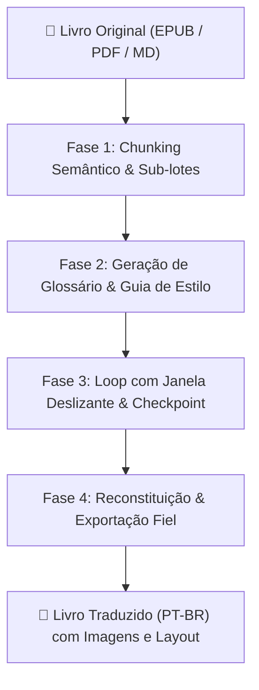

# 📚 Skill: Tradutor Editorial de Livros (Gemini Engine)

Esta skill capacita o agente a atuar como um **Tradutor Editorial Sênior** e orquestrador autônomo para verter livros completos, manuais técnicos e documentos extensos (300+ páginas) do inglês para o Português do Brasil (PT-BR).

Contorna a limitação de saída (*output tokens*) dos LLMs através de uma arquitetura de 4 fases com **particionamento semântico**, **glossário contextual**, **janela deslizante de continuidade** e **gravação atômica por lote (checkpoint)**.

---

## 🎯 Quando Ativar Esta Skill

Ative esta skill sempre que o usuário pedir para:
- Traduzir um livro inteiro ou capítulo em formato `.epub`, `.pdf`, `.md` ou `.txt`.
- Traduzir manuais técnicos, papers científicos ou e-books mantendo formatação, imagens e estrutura.
- Retomar uma tradução interrompida via checkpoint.
- Gerar ou auditar um glossário terminológico para tradução consistente.

---

## 🏗️ As 4 Fases da Arquitetura Editorial



### 1. Fase 1: Chunking Semântico & Sub-lotes HTML
- **EPUB (.epub):** Inspeciona cada item `ITEM_DOCUMENT`. Se o documento tiver mais de 9.000 caracteres (~1.800 palavras), agrupa os elementos filhos (`p`, `h1`, `div`, `blockquote`) em sub-lotes seguros. Garante que nenhuma resposta estoure o limite de saída ou sofra truncamento.
- **PDF (.pdf):** Converte via `pymupdf4llm` para Markdown estruturado, eliminando quebras falsas de página e cabeçalhos flutuantes.
- **Markdown / TXT:** Quebra por parágrafos duplos (`\n\n`) e títulos (`#`, `##`), nunca cortando frases ao meio.

### 2. Fase 2: Geração de Glossário & Guia de Estilo
- Lê uma amostra inicial da obra (até 35.000 caracteres).
- O Gemini analisa o tom (didático, médico, acadêmico, literário), forma de tratamento (voz do autor, uso de "você") e extrai termos técnicos, siglas (AI, EHR, ECG) e nomes próprios.
- Salva o arquivo `glossario_<nome>.json`. Se já existir, carrega-o para permitir customização pelo usuário.

### 3. Fase 3: Loop de Tradução com Continuidade & Checkpoint
- **Regras Estritas:** NUNCA resumir, NUNCA omitir parágrafos ou dados. Preservar rigorosamente tags HTML e sintaxe Markdown.
- **Janela Deslizante:** Envia os últimos 1.000 caracteres do bloco anterior já traduzido para manter concordância de pronomes, gênero e fluidez de leitura.
- **Gravação Bloco a Bloco:** Cada lote traduzido é gravado atomicamente em `checkpoint_<nome>.json`. Se a execução for interrompida, retoma imediatamente do ponto exato sem retrabalho.
- **Resiliência (Backoff Exponencial):** Tratamento automático de Rate Limits (código 429) e instabilidades temporárias de rede.

### 4. Fase 4: Reconstituição e Exportação Fiel
- **EPUB:** Substitui os fragmentos nos documentos do DOM, corrige UIDs do sumário (evitando erro do `ebooklib`/`lxml`) e regrava `<livro>_PTBR.epub` com todas as imagens, CSS, metadados e capa originais.
- **PDF / Markdown:** Exporta `<livro>_PTBR.md` e gera um arquivo `<livro>_PTBR.html` responsivo com tipografia de livro e botão para salvar/imprimir em PDF.

---

## 🛠️ Como Executar a Tradução Diretamente

O motor oficial da skill está disponível em:
`C:\Users\marlo\OneDrive\Desktop\Pasta Projetos\06_Agente_Tradutor_Livros\agente_tradutor.py`

### Execução via Linha de Comando / Background Task:
```powershell
python "C:\Users\marlo\OneDrive\Desktop\Pasta Projetos\06_Agente_Tradutor_Livros\agente_tradutor.py" --livro "<caminho_do_arquivo>"
```

### Parâmetros Suportados:
- `--livro` / `-l`: Caminho absoluto do arquivo (`.epub`, `.pdf`, `.md`, `.txt`).
- `--modelo` / `-m`: Modelo Gemini (padrão: `gemini-2.5-flash`).
- `--tamanho-bloco` / `-b`: Limite de caracteres por lote (padrão: `9000`).
- `--limite-lotes`: Traduz apenas os primeiros N lotes (ideal para validação rápida).
- `--recriar-glossario`: Força a regeneração do arquivo de glossário JSON.
- `--api-key`: Chave da API Gemini (carregada automaticamente do `.env` se omitida).

---

## 📋 Regras Editoriais Inegociáveis
1. **Fidelidade Total:** Uma tradução de 10 páginas em inglês deve gerar cerca de 10 a 11 páginas em português. Reduções drásticas de volume indicam resumo indevido e devem ser rejeitadas.
2. **Preservação de Tags:** Em EPUB, `<p class="...">`, `<em>`, `<strong>`, `<a>` e `` devem permanecer intocados em sua sintaxe, traduzindo apenas o texto visível interno.
3. **Glossário Vivo:** O glossário é a verdade soberana da obra. Qualquer termo nele definido deve ser traduzido de forma 100% uniforme do início ao fim do livro.
