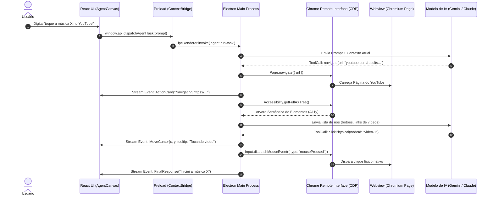

# 📘 Guia Definitivo: Arquitetura & Construção do Navegador com IA (Padrão Polar Browser)
### *Engenharia de Software, Estrutura de 3 Colunas (Split-Canvas) e Implementação em Electron + React/TypeScript*

---

## 🎯 1. Filosofia de Construção: "Não Reinvente a Roda"

O **Polar Browser** não foi compilado do zero em C++ modificando os 40 GB de código do Chromium. Ele é montado através da integração orquestrada de **4 pilares consolidados**:

1. **Shell Desktop Moderno (Electron / Node.js):** Gerencia janelas, abas, ciclo de vida e eventos do sistema operacional.
2. **Motor de Renderização Nativo (Chromium / WebView):** Executa HTML5, CSS3, JavaScript V8 e WebGL com isolamento de sessão e persistência de cookies/logins.
3. **Ponte de Controle Semântico (CDP - Chrome DevTools Protocol):** Permite à IA ler a **Árvore de Acessibilidade (A11y W3C)** em vez de capturas de tela pesadas, e despachar cliques físicos e digitação sem ser bloqueada por React/Vue.
4. **Interface de 3 Colunas (Split-Canvas Reativo):** Uma experiência limpa, predominantemente branca/neutra, onde a conversa com a IA e o navegador convivem lado a lado.

---

## 🏛️ 2. A Estrutura Visual Oficial de 3 Colunas (Split-Canvas)

A interface real do Polar Browser (extraída de gravação e telemetria) adota um layout de três zonas perfeitamente integradas:

```
┌────────────────────────────────────────────────────────────────────────────────────────────────────────┐
│ [≡]  [• Play Jogado aos Tubarões... ×]  [⚙ Settings]  [+]                       [N1] [─] [□] [✕]      │ (AppHeader)
├──────────────────────┬────────────────────────────────────────────┬────────────────────────────────────┤
│ 🔍 ◫                 │ [Share]                                [◫] │ [▶ Diego e Victor Hugo... 🔊 ×] [+]│ (BrowserTabs)
│ [+ New task]         ├────────────────────────────────────────────┼────────────────────────────────────┤
│                      │                                            │ [<] [>] [↻] [🔒 youtube.com/...  ] │ (BrowserNav)
│  Workflows          │   [User: abra o youtube toque a musica... ]│                                    │
│ ⊞ Templates          │                                            │                                    │
│ ⚙ Customize          │   > 2 steps                                │          CANVAS WEBVIEW            │
│                      │   Thought for 1s                           │           DO CHROMIUM              │
│ PROJECTS             │   [Creating Tab https://youtube.com...]    │                                    │
│ No projects          │   Vou abrir o YouTube e buscar a música... │     (Ex: Player do YouTube,        │
│                      │                                            │      SaaS, CRM ou LinkedIn)        │
│ RECENTS              │   [Navigating https://...]                 │                                    │
│ • Tubarões (Ativo)   │   [Tocando The Lazy Song]                  │                                    │
│ • Justin Bieber      │                                            │         ↖ [Tocando Música]         │
│ • LinkedIn Login     │                                            │           (Ghost Cursor Tooltip)   │
│                      ├────────────────────────────────────────────┤                                    │
│ GET STARTED          │ ┌────────────────────────────────────────┐ │                                    │
│ ✔ Run first task     │ │ Send a follow up, / for commands...    │ │                                    │
│ ○ Ask on any page    │ │ [+] [Medium ▾]           [🎙️] [↑ Send] │ │                                    │
│ ○ Connect an app     │ └────────────────────────────────────────┘ │                                    │
└──────────────────────┴────────────────────────────────────────────┴────────────────────────────────────┘
  COLUNA 1: SIDEBAR      COLUNA 2: AGENT CONVERSATION CANVAS          COLUNA 3: EMBEDDED REAL BROWSER
    (Navegação & Recents)      (Pensamento, Ações e Prompt)             (Webview + Tooltip de Ação)
```

### Detalhamento das 3 Colunas:

1. **Coluna 1 — Sidebar Lateral (`#fbfbfb`, ~240px de largura):**
   - **Topo:** Busca global rápida e botão de recolher a barra.
   - **Botão Primário:** `+ New task` para iniciar uma sessão de trabalho limpa.
   - **Menu Principal:** *Workflows* (rotinas salvas), *Templates* (prompts pré-configurados) e *Customize*.
   - **Recents:** Histórico de tarefas com pontinhos coloridos de status (ex: azul = executando/concluído, laranja = aguardando autenticação/captcha).
   - **Get Started:** Checklist de onboarding para o usuário.

2. **Coluna 2 — Agent Conversation Canvas (`#ffffff` puro, largura flexível):**
   - **Topo:** Botão `Share` e alternador de layout (Split-View ou Janela Flutuante Picture-in-Picture).
   - **Mensagens do Usuário:** Pílulas cinza claro (`#f3f4f6`) alinhadas à direita.
   - **Blocos de Raciocínio (*Chain of Thought*):** Marcadores `Thought for 1s` e `> X steps` colapsáveis.
   - **Cards de Ação (*Tool Invocations*):** Caixas sutis com borda `#e5e7eb` exibindo o que a IA está executando em tempo real (`Creating Tab`, `Navigating`, `Performing Action`, `Getting Page Text`).
   - **Feedback do Usuário:** Ações de `👍`, `👎`, cópia e menu contextual.
   - **Input Box Flutuante:** Caixa de texto arredondada com seletor **Effort (Medium ▾)** de 4 níveis (*Low, Medium, High, Max*), microfone para ditado por voz e botão circular azul de envio.

3. **Coluna 3 — Embedded Real Browser (Webview do Chromium):**
   - **Abas Web Dedicadas:** Abas da página navegada com favicons, títulos e indicador sonoro (`🔊`).
   - **Barra de Navegação Web:** Botões de histórico (`< >`), recarregamento (`↻`) e Omnibar de URL com cadeado SSL.
   - **Superfície Web Real:** Onde o Chromium renderiza o site acessado.
   - **Cursor Fantasma com Tooltip:** Ponteiro virtual com pílula de texto anexada (`[Tocando The Lazy Song]` ou `[Preenchendo Formulário]`), informando visualmente o que o agente está fazendo na página.

---

## 🧩 3. Hierarquia dos Componentes React (`src/renderer/src/components`)

```
App.tsx
├── AppHeader.tsx                 // Abas superiores de tarefas, avatar e controles de janela
└── LayoutContainer (Flex Row)
    ├── Sidebar.tsx               // Coluna 1: New task, navegação, recents e checklist
    ├── AgentCanvas.tsx           // Coluna 2: Histórico de chat, pensamentos e cards de ação
    │   ├── MessageList.tsx       // Balões do usuário e respostas estruturadas da IA
    │   │   ├── ThoughtBlock.tsx  // "Thought for 1s" colapsável
    │   │   ├── ActionCard.tsx    // "Creating Tab...", "Navigating..."
    │   │   └── IntegrationBanner.tsx // "Connect YouTube..."
    │   └── ChatInputBox.tsx      // Textarea, botão +, EffortPopover, Mic e Enviar
    │       └── EffortPopover.tsx // Slider de esforço: Low, Medium, High, Max
    └── BrowserPane.tsx           // Coluna 3: Webview embutida
        ├── BrowserTabBar.tsx     // Abas web da página atual
        ├── BrowserNavBar.tsx     // Voltar, avançar, recarregar e barra de URL
        ├── WebViewContainer.tsx  // Tag <webview> do Electron
        └── GhostCursor.tsx       // Cursor virtual da IA com tooltip dinâmico
```

---

## ⚡ 4. Arquitetura de Comunicação (IPC + CDP Bridge)



---

## 🛠️ 5. Implementação Prática do Core (Código Real)

### 5.1 O Processo Principal (`src/main/index.ts`)
```typescript
import { app, BrowserWindow, ipcMain } from 'electron';
import CDP from 'chrome-remote-interface';
import path from 'path';

// Porta de depuração obrigatória para que a IA controle o Chromium
app.commandLine.appendSwitch('remote-debugging-port', '9222');
app.commandLine.appendSwitch('disable-features', 'PreloadMediaEngagementData');

let mainWindow: BrowserWindow | null = null;
let cdpClient: any = null;

async function createWindow() {
  mainWindow = new BrowserWindow({
    width: 1400,
    height: 900,
    frame: false, // Frame customizado no estilo Polar
    webPreferences: {
      preload: path.join(__dirname, '../preload/index.js'),
      webviewTag: true, // Habilita a tag <webview> para a Coluna 3
      nodeIntegration: false,
      contextIsolation: true
    }
  });

  mainWindow.loadURL(process.env.ELECTRON_RENDERER_URL || `file://${path.join(__dirname, '../renderer/index.html')}`);
}

// Inicializa a ponte CDP com a Webview
ipcMain.handle('cdp:attach', async (_, targetId) => {
  cdpClient = await CDP({ port: 9222, target: targetId });
  const { Page, DOM, Accessibility, Input } = cdpClient;
  await Promise.all([Page.enable(), DOM.enable(), Accessibility.enable()]);
  return { status: 'attached' };
});

// Ação de Clique Físico Anti-Ghost
ipcMain.handle('cdp:click', async (_, { x, y }) => {
  if (!cdpClient) throw new Error('CDP não conectado');
  const { Input } = cdpClient;
  await Input.dispatchMouseEvent({ type: 'mouseMoved', x, y });
  await Input.dispatchMouseEvent({ type: 'mousePressed', x, y, button: 'left', clickCount: 1 });
  await Input.dispatchMouseEvent({ type: 'mouseReleased', x, y, button: 'left', clickCount: 1 });
  return { success: true };
});

app.whenReady().then(createWindow);
```

### 5.2 O Preload Bridge Seguro (`src/preload/index.ts`)
```typescript
import { contextBridge, ipcRenderer } from 'electron';

contextBridge.exposeInMainWorld('api', {
  attachCDP: (targetId: string) => ipcRenderer.invoke('cdp:attach', targetId),
  clickPhysical: (x: number, y: number) => ipcRenderer.invoke('cdp:click', { x, y }),
  navigate: (url: string) => ipcRenderer.invoke('cdp:navigate', url),
  onAgentEvent: (callback: (event: any) => void) => {
    ipcRenderer.on('agent:event', (_, data) => callback(data));
  }
});
```

---

## 🔒 6. As Regras de Ouro Aprendidas na Engenharia Reversa

1. **Nunca use `eval()` ou scripts injetados na página:** Frameworks modernos como React, Vue e Angular ignoram atribuições diretas de variáveis no DOM. Sempre use `Input.dispatchMouseEvent` e `Input.dispatchKeyEvent` via CDP.
2. **Preserve a sessão e os cookies do usuário:** Ao utilizar o mesmo perfil de usuário do Chromium, o agente herda o login no YouTube, Google, LinkedIn e CRMs sem precisar passar credenciais em texto puro para a LLM.
3. **Ghost Pointer com Tooltip reduz ansiedade do usuário:** Quando a IA opera no navegador, o usuário precisa ver exatamente o que ela está fazendo. O ponteiro com a pílula de texto (*"Tocando música"*, *"Buscando resultados"*) transforma uma experiência de caixa-preta em um copiloto transparente e confiável.
